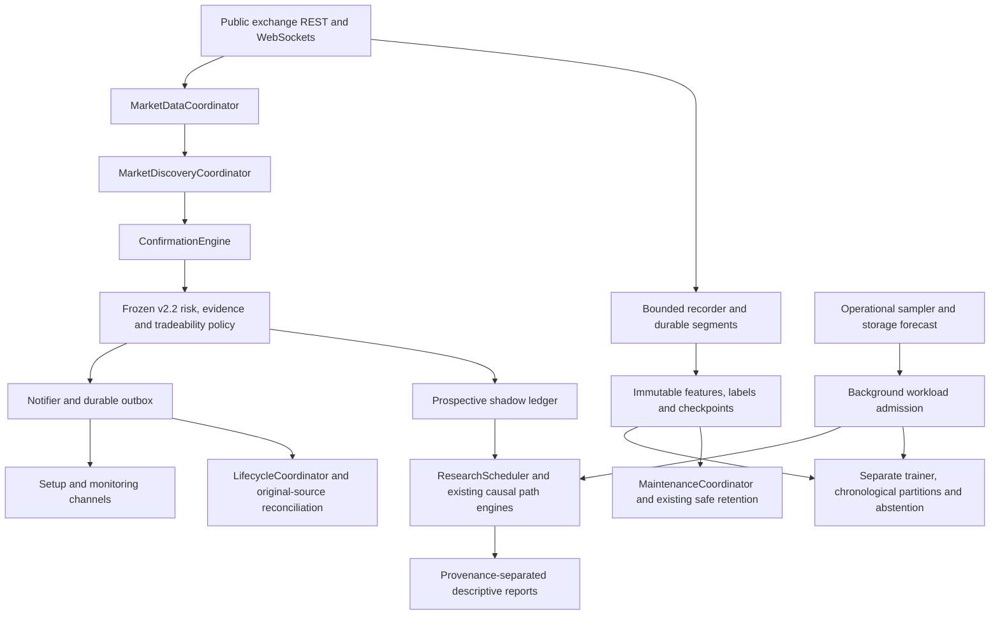

# Reliability & Evidence Loop — 2.2.1

This maintenance release surrounds the existing v2.2 policy with operational
controls and prospective evaluation. It does not establish a profitable edge.
The strategy IDs, score weights, candidate-v20 schema, 500-outcome/sequence
requirements, source isolation, lifecycle and Discord eligibility are unchanged.

## Component responsibilities



MarketDataCoordinator owns candle/feature/derivative caches and REST concurrency
state. Explicit Scanner properties preserve the existing integration surface.
Scanner remains the composition root and shared session context. Its public
methods are compatibility delegates. Services have explicit runtime-port protocols
and own their named algorithms/scheduling. Existing lifecycle/replay/notification
engines remain independent. This is an incremental extraction: clients and some
session state are still shared through Scanner, and the protocols use `Any` where
legacy interfaces remain dynamic. They are not independent network services.
Algorithm fingerprints compare extracted method bodies against reviewed main
82051a14; research-loop changes are separately tested workload admission/hooks.

Other large modules remain intact intentionally. Recording maintenance owns one
lease/inventory/release transaction; ML completeness owns schema/provenance and
partition readiness; notifications owns receipt/uncertainty handling; Store owns
acknowledged persistence. Splitting those solely by line count would obscure their
invariants. SQLite instrumentation and ordered migrations now have separate owners.

## Forward evidence

A durable prospective epoch starts on the first application startup with this
release. Earlier candidates are excluded. New flow-confirmed v2.2 opportunities
freeze their candidate identity, source, decision time, scores, entry/cost/stop,
execution/structural objectives and policy assessments. Duplicate economic
identities cannot create extra observations. An independent `:forward` research
path starts at that decision, rather than borrowing an earlier provisional path.
No future candles are inputs to policy assessment. Enrollment errors are counted
and cannot roll back an acknowledged deterministic decision.

Seven shadow assessments are recorded: actual v2.2, its saved frozen v21.1
trade-quality control, and fixed-component controls without OFI, impact efficiency,
target reachability, stop viability or execution-target replacement. The v21.1
control retains shared current-entry evidence; it is not an end-to-end replay of
an old scanner. The structural-target control recalculates saved causal assessments
on a copy; it does not invent an alternate fill. Missing controls are
`NOT_COMPARABLE`. Ablated components remain explicitly unknown, with fixed weights
and no weight optimization. Controls never influence production.

Existing incremental one-minute path research supplies net R, excursion lower
bounds, +0.25/0.50/0.75/1R times, stop-before milestones, target reaches and time exits.
Entry/stop/target ordering ambiguity and missing coverage remain unknown. Labels
are append-only. Research paths are not verified account fills or exact tick
MFE/MAE. No retrospective backfill is presented as prospective evidence.

The ledger distinguishes `verified_prints`, `recovered_prints`,
`monitored_ohlc_proxy` and `research_only`. Existing immutable labels are joined
only for the actual-policy plan, matching source, decision time and prices;
recovered prints also require their verified certificate. Alternate-target results
require their own causal replay and cannot borrow actual-policy prints outcomes.
Unrecorded path metrics remain null. Results are never pooled across source,
policy or provenance. A bounded report displays its row limit/truncation explicitly.

```sh
docker compose exec desk bybit-flow forward-report
```

The overview shows **FORWARD OBSERVATION / NOT VERIFIED ACCOUNT PERFORMANCE**.
Score bands use each variant's frozen score; the v21.1 control does not fabricate
a comparable Setup Score. Only observed bands appear. Cohorts cover source,
family, horizon, direction, regime and reachability/stop/impact/OFI states.
Below 30 complete observations a cohort says **INSUFFICIENT SAMPLE**, suppressing
rates. Thirty is a reporting safeguard, not proof of independence or an ML gate.
Means/medians remain descriptive. Paired comparison reports expose loss avoidance,
winner rejection and hypothetical incremental net R; they cannot promote policy.

A manual research review can be recorded with `bybit-flow policy-review review.json`.
Required keys are `policy_id`, `parent_policy`, `development_period`,
`forward_start`, `evaluation_end`, `sample_counts`, `net_r`, `mfe`, `mae`,
`loss_avoidance`, `winner_rejection`, `subgroup_stability`, `attempted_variants`,
and `code_commit`. Records have no production authority. Changing production
still requires a reviewed source change and separate deployment.

## Database and migrations

Startup uses the ordered `migration_registry` (ID, name, checksum, applied time).
001–008 preserve existing legacy ensure steps; 009 adds the reliability tables.
Checksums cover migration code and associated SQL. Unknown/mismatched receipts
must be investigated; never edit a receipt merely to bypass an integrity error.
New migrations should be appended, not rewritten. The new migration and its receipt
are transactional. Some legacy SQLite scripts commit internally and are recorded
as repeatable compatibility steps. Old v1/v2.2 schema fixtures verify immutable
rows, indexes/views and repeated startup. No historical labels/plans are normalized.

SQLite measurements include write/read/transaction latency, busy events/retries,
WAL bytes and passive checkpoint progress. Samples are bounded; no SQL text,
webhook URLs or payloads are logged. Runtime connections do not synchronously sleep
through lock retries. The owning connection waits at most 25 ms for a competing
writer. A bounded asynchronous pump coalesces cached diagnostics, storage health
and supervisor status on that same connection, with read-your-write overlays.
It yields between rows and never commits an existing critical transaction.
This avoids an independent diagnostic writer racing critical writes. Critical receipts, lifecycle
and evidence writes are never enqueued: they acknowledge or raise/fail closed.
HTTP lock conflicts return 503 with Retry-After. Existing supervision retries the
operation according to its own semantics; uncertain delivery is never blindly retried.
Offline/worker connections retain their existing retry behavior.

Low-pressure background sampling may run a **PASSIVE** WAL checkpoint. It never
forces FULL/TRUNCATE checkpoints or deletes a WAL. Long read transactions can
still hold WAL pages. SQLite reads/critical transactions are still synchronous;
this release removes blocking retry waits rather than claiming zero loop latency.

## Workload priority and local telemetry

Priority is recording → active lifecycle → required feeds → confirmation/delivery
→ scanning → forward research → historical recovery → training/bootstrap.
Only the last three classes can be deferred by the new admission controls.
Required volume profiles/V8 observations and production gates retain their behavior.
Existing recorder/storage guards still apply when new telemetry is unavailable.

Measured pressure creates NORMAL, TRAINING_DEFERRED, RECOVERY_DEFERRED,
RESEARCH_DEFERRED or CRITICAL_COLLECTION_PROTECTION. These states admit workload,
not trades. Queue/byte pressure, loop lag, SQLite conflicts, REST backlog,
container memory, storage and required-feed freshness are inputs. Operational
cutoffs are documented in `operational.classify`; they are not optimized strategy
parameters. Fresh admission state expires after 90 seconds; stale observed state defers optional
load. Stores without a new sampler history retain their existing recorder guards.

A one-second lag probe rolls into at most one persisted sample/minute for two days.
Metrics include recorder pressure/drops, SQLite timing/WAL, scan/confirmation and
REST timing/errors, Discord POST/PATCH timing/errors/rate limits, WebSocket reconnects,
training attempts/duration, worker state and sampled recovery backlog. Counters
are process scoped; missing measurements remain unavailable. `/api/operations`
and `doctor --json` expose snapshots. The API also supplies a bounded recent series.
No paid telemetry backend is required.

Doctor warnings include EVENT_LOOP_LAG, SQLITE_CONTENTION, WAL_GROWTH,
RECORDER_PRESSURE, RECOVERY_BACKLOG and STORAGE_EXHAUSTION_FORECAST, with measured
values, expected ranges and actions. Original feed/clock/delivery warnings remain.
A clock-check network failure is not proof that Windows needs another sync.

## Storage and recovery

Hourly category samples are retained for 45 days: database, WAL, raw segments,
packs, datasets, models, maintenance/audit, research exports and other files.
The sampler runs off the collector loop. Growth windows need actual 24h/7d/30d
history; otherwise they report UNKNOWN. Values are bytes/day and include existing
retention reductions. Positive observed growth gives a linear days-to-budget
estimate, not a storage guarantee. Declining/insufficient history stays UNKNOWN.

Existing storage inventory identifies protected/reclaimable raw and permanent
bytes. Physical database size contains metadata and permanent derived evidence;
this release does not pretend to separate their physical pages. Models/datasets
and category growth distinguish permanent growth from a raw-retention backlog.
No deletion policy, raw fidelity or evidence protection is changed.

The common recovery view maps existing durable attempts/path jobs to PENDING,
WAITING_SOURCE, READY, REPLAYING, RETRY_AT, COMPLETE, UNVERIFIABLE or FAILED_SOFTWARE.
It exposes job/source/symbol/cursor/window/attempt/retry/progress where recorded.
Unknown legacy fields remain null. NETWORK_TIMEOUT, RATE_LIMIT,
SOURCE_HISTORY_UNAVAILABLE, DATA_GAP, CLOCK_DAMAGE, RETENTION_MISSING,
INVALID_FROZEN_PLAN, AMBIGUOUS_ORDERING and SOFTWARE_ERROR remain distinct.
Each engine still owns its checkpoint, causal proof, fairness and immutable labels.
Unattempted primary candidates remain in existing eligibility reports, not invented
recovery jobs. The view is bounded and explicitly reports sampling/truncation.

## Dashboard and validation

The first screen surfaces operator priorities, all current valid opportunities,
published plans versus current thesis health, live midpoint/R progress, blocked
reasons, shared direction context and forward results. A current quote is shown
only from the original source's fresh reconstructed book. A shared-direction count
is not an estimated correlation. Existing opportunity correlation context remains
available where measured. All ranks are informational; no top-N delivery cap exists.
Deep research, ML, order flow, delivery and health pages remain available.

Run `python scripts/verify.py`. CI retains Python 3.12/3.13, Ruff, formatting, JS,
offline research and recorder soak. Its additional isolated Compose job builds,
starts, checks health/offline doctor/version, verifies graceful shutdown and restores
a migrated backup into a different disposable volume. It has no production .env,
network access, webhook or fixed host port. Only its own unique test volumes are
removed. CodeQL and high/critical dependency review use GitHub's public-repository
features ([CodeQL](https://github.com/github/codeql-action),
[dependency review](https://github.com/actions/dependency-review-action)). Triage findings against reachability; suppress only with a documented
reason. Low-confidence alerts are reviewed, not automatically made release gates.

See [deployment and rollback](DEPLOYMENT.md) for separate operating workflows.

## Independent storage upkeep

The default Compose `maintenance` service has a 512 MB memory limit, one-quarter
CPU and no network. It does not depend on the optional trainer. Above 85% storage
usage it materializes the existing prints-v1 outcome policy in chronological
batches, then invokes existing verified retention. It shares an exclusive primary
checkpoint lock with normal labeling, preventing two materializers from advancing
one checkpoint concurrently. SQLite contention defers the iteration and retries.

Each pass selects at most 16 ordinary segments and 64 MB of compressed input.
Overlapping/equal receipt boundaries stay together (hard limit 128 segments).
An oversized group is deferred rather than partially consumed. All selected
segments pass the existing integrity preflight before replay. A truncated batch
never substitutes wall time for the observation boundary, so later positions are
not falsely finalized as incomplete. A full caught-up pass uses the existing
live-cutoff rules, including genuine recording gaps. No old labels are rewritten.

Training, fitting, backfills and model promotion do not run in this service. Raw
pruning retains active plans, unresolved outcomes, leases and immutable derived
records. If protected/permanent data fills the budget, recording still fails
closed and the dashboard names the capacity blocker. A finite budget cannot
preserve unlimited permanent history; service restarts cannot solve that condition.
